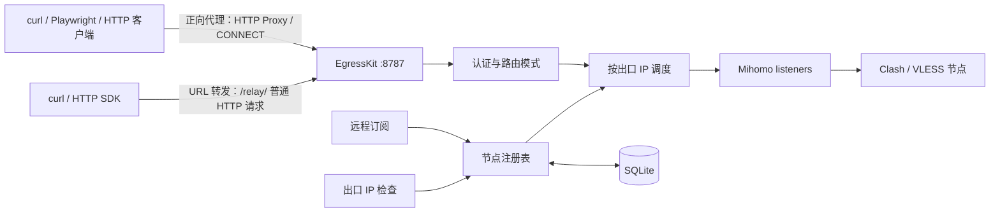
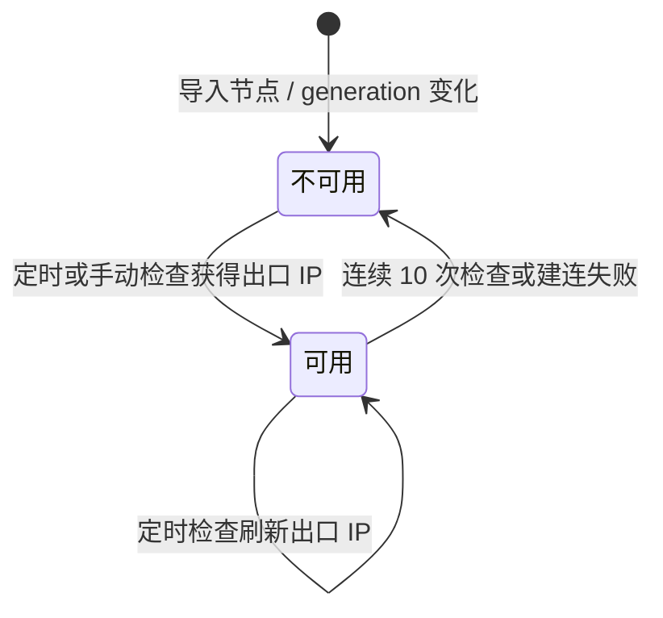

# EgressKit

<p align="center">
  
</p>

<p align="center">将 Clash / VLESS 节点聚合为一个可编程的 HTTP 代理入口。</p>

<p align="center">简体中文 · <a href="README_EN.md">English</a></p>

EgressKit 是一个开源、自托管的代理网关。客户端只连接一个 HTTP 代理地址，通过代理用户名选择轮换出口、会话粘连、严格粘连或指定出口。订阅更新、Mihomo、节点探活、出口 IP 识别、调度和失败回退都由 EgressKit 处理。

> [!IMPORTANT]
> 当前镜像支持 Linux amd64 和 arm64。Windows 不在 v1 支持范围内。

> [!WARNING]
> 状态数据库会以明文保存订阅 URL、节点凭据和 Proxy Token。生产环境必须保护状态目录和备份，并保持代理认证开启。

## 快速开始

### 启动 EgressKit

```bash
docker pull heyjunpenn/egresskit:latest

read -rsp "Admin Token: " EGRESSKIT_ADMIN_TOKEN && echo

docker run --detach \
  --name egresskit \
  --restart unless-stopped \
  --volume egresskit-state:/var/lib/egresskit \
  --publish 127.0.0.1:8787:8787 \
  --env EGRESSKIT_ADMIN_TOKEN \
  heyjunpenn/egresskit:latest
```

打开 <http://127.0.0.1:8787>，输入 Admin Token。


```bash
curl --fail http://127.0.0.1:8787/live
```

### 导入订阅

进入“订阅管理”，点击“添加订阅”，填写名称和 Clash / Mihomo HTTPS 订阅地址，然后点击“导入”。订阅地址包含凭据，只应输入控制台，不要写入仓库或日志。


节点导入后还要识别出口 IP。所有节点都会进入验证队列，出口识别单次最多并发 5 个；节点较多时需要等待几分钟。

```bash
until curl --fail --silent http://127.0.0.1:8787/ready; do
  sleep 5
done
echo
```

`/live` 只表示进程存活；`/ready` 返回 `{"status":"ready"}` 才表示 Mihomo 和至少一个已验证出口可以接流量。


### 用 curl 发起请求

代理使用 HTTP Basic Auth。用户名表示路由模式，密码填写 Proxy Token。Proxy Token 首次与 Admin Token 相同，生产环境应在“设置”页重置为单独的随机值。

```bash
read -rsp "Proxy Token: " EGRESSKIT_PROXY_TOKEN && echo

curl --silent --show-error --max-time 30 \
  --proxy 'http://127.0.0.1:8787' \
  --proxy-user "rotate:${EGRESSKIT_PROXY_TOKEN}" \
  'https://www.cloudflare.com/cdn-cgi/trace'
```

成功响应应包含 `visit_scheme=https`、`tls=`、`http=`、`loc=` 和出口 `ip=`。访问 HTTPS 目标时，curl 会先向 EgressKit 建立 CONNECT 隧道，再由选中的 Mihomo 节点连接目标。

也可以在“快速操作”页面选择“正向代理”或“URL 转发”，点击“检查出口 IP”填写 IP 查询目标，再点击“发起请求”，查看请求日志、对应的 curl 示例和响应结果。接入方式与 Rotate / Sticky 等选路模式分别选择。


> 截图来自隔离验证容器，其中使用了测试端口 `18787`；按本文启动时使用 `8787`，操作方式相同。截图中的订阅地址、节点名称、Token 和出口信息均已遮盖。

## 接入方式

| 接入方式 | 客户端请求 | 认证 | 对外部署 |
| --- | --- | --- | --- |
| 正向代理（Forward proxy） | 配置 HTTP 代理，HTTPS 目标使用 CONNECT | 代理用户名选择路由，密码为 Proxy Token | 直连代理端口或四层 TCP 转发 |
| URL 转发（Relay，反向代理请求） | 请求 `/relay/<路由>/<协议>/<目标主机>/<路径>` | `X-EgressKit-Token` 为 Proxy Token | 可经普通 CDN / HTTP 反代转发 |

接入方式决定客户端如何连接网关；下面的 Rotate / Sticky 等选路模式决定使用哪个出口。
两种接入方式共用出口 IP 调度与会话绑定规则。

### 查询出口 IP

正向代理：

```sh
curl --silent --show-error --max-time 30 \
  --proxy 'http://proxy.example.com:8787' \
  --proxy-user 'rotate:YOUR_PROXY_TOKEN' \
  'https://api.ipify.org'
```

URL 转发：

```sh
curl --silent --show-error --max-time 30 \
  'https://egress.example.com/relay/rotate/https/api.ipify.org/' \
  -H 'X-EgressKit-Token: YOUR_PROXY_TOKEN'
```

替换示例域名与 Proxy Token。响应正文是所选出口的公网 IP；Rotate 每次新请求可能选择不同出口。
控制台操作步骤、请求日志和生成示例的说明见 [快速操作指南](docs/playground.md)。

## 路由模式

| 代理用户名 | 用途 | 出口不可用时 |
| --- | --- | --- |
| `rotate` | 为每个新请求或 CONNECT 隧道选择最长未使用的出口 IP | 建连确认前尝试其他可用出口 |
| `sticky.<session-key>` | 相同 session key 尽量保持同一出口 IP | 可以重新绑定其他出口 IP |
| `strict.<session-key>` | 相同 session key 严格保持同一出口 IP | 同 IP 的传输节点均不可用时失败 |
| `node.<alias-or-id>` | 使用指定节点所代表的出口 IP | 仅在同 IP 的传输节点之间回退 |

`rotate` 的轮换单位是新 HTTP 请求或新 CONNECT 隧道。已经建立的 HTTPS 隧道不会中途切换出口。

```bash
curl \
  --proxy 'http://127.0.0.1:8787' \
  --proxy-user "sticky.crawler-job-42:${EGRESSKIT_PROXY_TOKEN}" \
  'https://example.com'
```

Playwright 示例：

```typescript
import { chromium } from "playwright";

const browser = await chromium.launch({
  proxy: {
    server: "http://127.0.0.1:8787",
    username: "sticky.playwright-session",
    password: process.env.EGRESSKIT_PROXY_TOKEN,
  },
});

const page = await browser.newPage();
await page.goto("https://example.com");
```

浏览器通常会复用连接。需要重新选择出口时，应创建新的浏览器上下文或连接，而不是依赖页面请求次数。

### URL 转发：经 CDN / HTTP 反代发送请求

客户端可以发送普通 HTTP 请求，无需配置 `--proxy`：

```sh
curl 'https://egress.example.com/relay/rotate/https/api.ipify.org/' \
  -H 'X-EgressKit-Token: YOUR_PROXY_TOKEN'
```

路径格式为 `/relay/<路由模式>/<http|https>/<目标主机及端口>/<目标路径>?查询参数`。
路由模式沿用 `rotate`、`sticky.session-demo`、`strict.session-demo` 和 `node.<selector>`；每个 relay 请求独立选路。
SDK 可把 BaseURL 设置为 `https://egress.example.com/relay/sticky.session-demo/https/api.example.com/v1`，
并添加 `X-EgressKit-Token`。目标服务的 `Authorization`、请求方法和请求体照常发送。
节点 ID/alias 等路由值放入 URL 时须对整个路由段进行 URL 编码。

请求与响应流式转发，支持 POST 和 SSE；目标重定向会改写为 relay 地址。网关会验证目标 TLS 证书，
可以读取此模式的业务内容，且不会把网关 Token 转发至目标。它适合 Web API 与抓取请求；
Playwright 整站浏览、WebSocket 与客户端 TLS 指纹控制继续使用正向代理。
部署示例见 [CDN / HTTP 反代配置](docs/deployment.md#cdn--http-反代接入)。

## 工作原理

EgressKit 不直接实现 VLESS。它使用一个独立的官方 Mihomo 进程承载全部节点 listener，并在其上提供统一的 HTTP 代理入口。



多个节点可能共用一个公网 IP，所以 EgressKit 按经过验证的出口 IP 调度，而不是按节点数量轮换。`rotate` 先选择最长未使用的 IP 组，再从组内选择可用节点；sticky、strict 和指定节点模式也都绑定到出口 IP。

### 代理生命周期



节点只显示“可用”和“不可用”两种状态。有已验证出口 IP 才可用；连续 10 次检查或建连失败后撤销出口 IP 并停止调度。定时任务按节点顺序每轮检查 10 个，单次最多并发 5 个；手动检查支持单个或全量执行。人工停用也不会进入调度池。

对于 HTTPS，EgressKit 在返回 `200 Connection Established` 前可以尝试其他出口。隧道建立后只转发加密字节，不解密内容，也不会自动重放请求；连接中断时由客户端决定是否重连。

## 已知限制

- EgressKit 不提供节点或订阅；当前只从 Clash / Mihomo 订阅中导入 VLESS 节点。
- `rotate` 按新的 HTTP 请求或 CONNECT 隧道选择出口。客户端复用连接时，隧道内的多个 HTTPS 请求仍使用同一出口。
- CONNECT 隧道建立后不能无感切换出口或重放请求。上游连接中断时，由客户端重新连接。
- URL 反向代理入口支持经普通 CDN / HTTP 反代接入，需禁用缓存与自动重试，并确认其支持请求体大小及流式超时要求。标准 HTTP Proxy / CONNECT 接入仍需直连代理端口或四层 TCP 转发。
- SQLite 会明文保存订阅 URL、节点凭据和 Proxy Token。部署者需要保护状态目录及其备份。

## 配置与数据

`EGRESSKIT_ADMIN_TOKEN` 为必填环境变量。公开入口可通过以下可选环境变量配置，启动时读取，修改后需重启服务（Docker 需重新创建容器）：

```sh
export EGRESSKIT_PUBLIC_PROXY_URL=http://proxy.example.com:8787
export EGRESSKIT_PUBLIC_RELAY_URL=https://egress.example.com
```

| 环境变量 | 用途 |
| --- | --- |
| `EGRESSKIT_PUBLIC_PROXY_URL` | 正向代理入口，更新页面展示和 `curl --proxy` 示例 |
| `EGRESSKIT_PUBLIC_RELAY_URL` | URL 转发入口，更新页面展示和 `/relay/...` 示例 |

只填写协议、主机和可选端口，不添加 `/relay/`、目标路径、认证信息、查询参数或片段。
变量用于页面展示、复制及调用示例，不保存到 SQLite，也不修改监听端口或部署转发规则。
未设置或留空时自动生成；默认地址和 Docker 配置见 [部署指南](docs/deployment.md#配置对外入口地址)。
其他运行配置首次启动时写入 SQLite，并通过控制台更新。

| 配置 | 默认值 |
| --- | ---: |
| 监听地址 | `0.0.0.0:8787` |
| 出口 IP 检查周期 | 30 秒 |
| 每轮出口 IP 检查数 | 10 |
| 出口 IP 探测并发 | 5 |
| 订阅刷新周期 | 600 秒 |
| 建连前尝试次数 | 3 |
| 单次建连超时 | 10 秒 |

Docker 状态目录为 `/var/lib/egresskit`。SQLite 保存订阅、节点、出口身份、会话绑定、设置和处理记录，不保存每个代理请求或数据包。

## 故障排查

```bash
docker ps --filter name=egresskit
curl --include http://127.0.0.1:8787/live
curl --include http://127.0.0.1:8787/ready
docker logs --tail 100 egresskit
```

- `407 Proxy Authentication Required`：Proxy Token 错误，或客户端没有发送代理认证。
- `502 Bad Gateway`：当前候选无法连接目标；检查节点状态、订阅有效性和容器网络。
- `/ready` 返回 503：当前没有已启用且持有已验证出口 IP 的节点。
- Rotate 没有换 IP：客户端可能复用了 CONNECT 隧道，或多个节点共用同一公网 IP。
- IP 查询返回 429：查询站点触发限流，不代表 EgressKit 没有轮换。

## License

EgressKit 使用 Apache-2.0 许可证。Mihomo 作为独立的 GPL-3.0 进程运行；相关许可证、归属和对应源码说明包含在 Docker 镜像中。

## 友情链接

- [LINUX DO](https://linux.do) — 新的理想型社区
