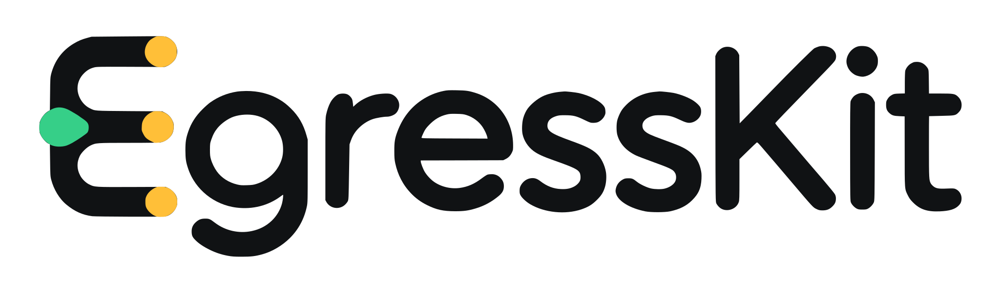
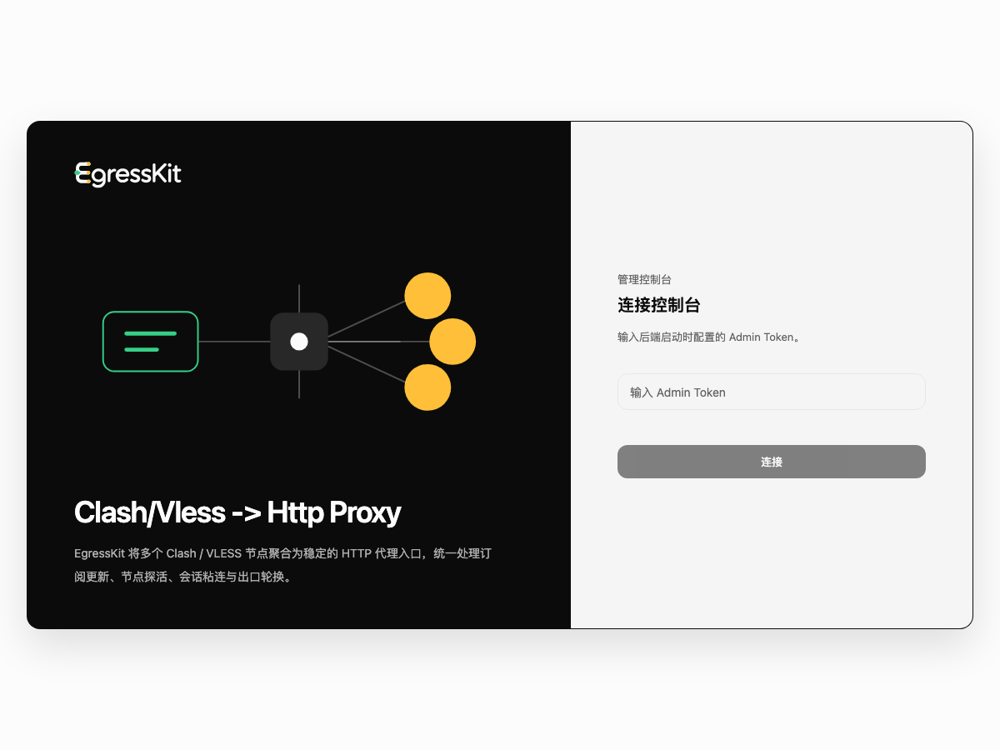
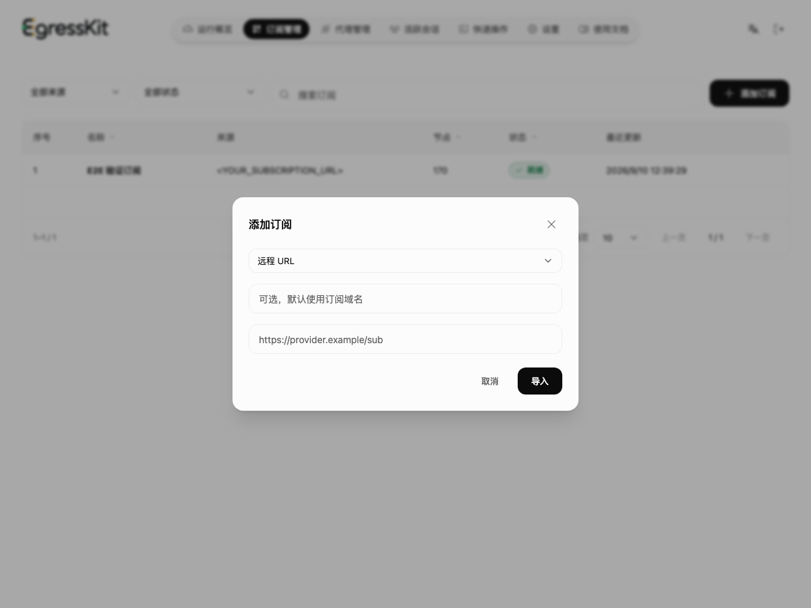
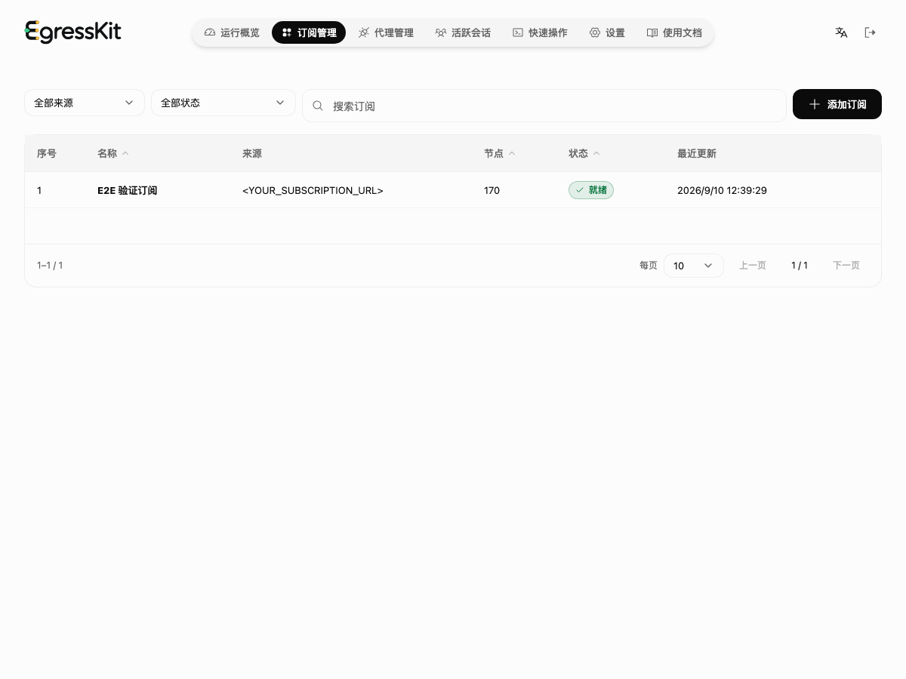
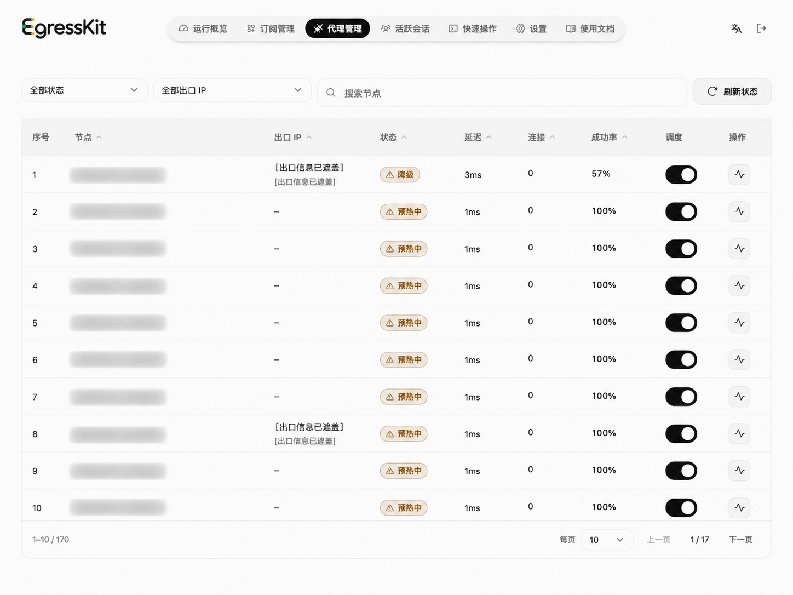
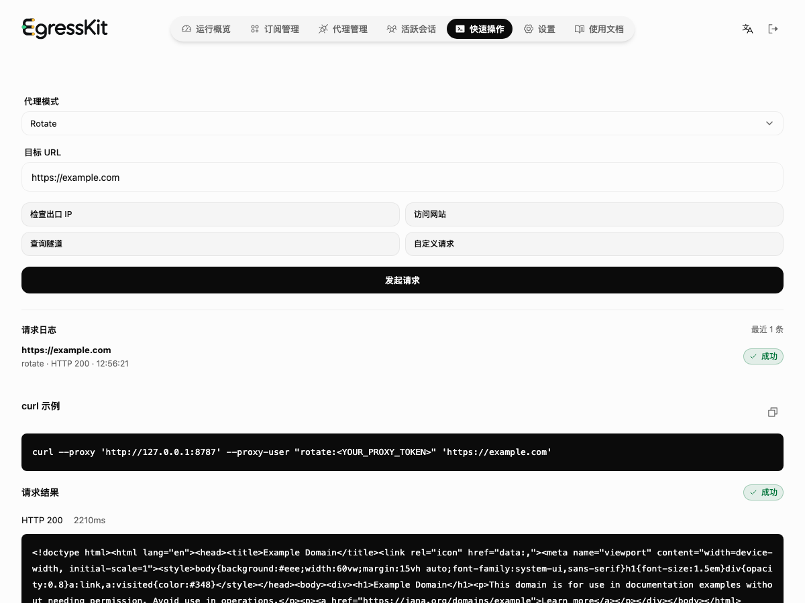
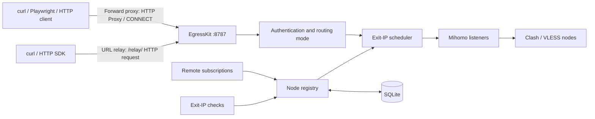
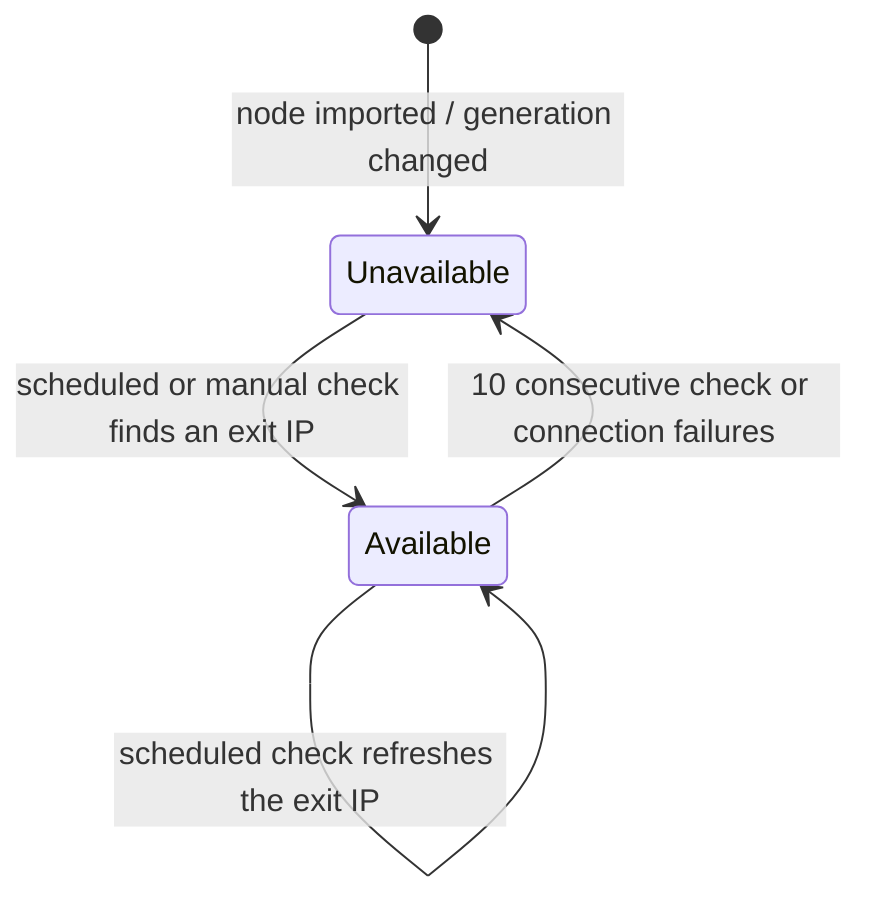

# EgressKit

<p align="center">
  
</p>

<p align="center">Aggregate Clash / VLESS nodes behind one programmable HTTP proxy endpoint.</p>

<p align="center"><a href="README.md">简体中文</a> · English</p>

EgressKit is an open-source, self-hosted proxy gateway. Clients connect to one HTTP proxy and select rotating, sticky, strict-sticky, or explicit egress routing through the proxy username. EgressKit handles subscription updates, Mihomo, health checks, exit-IP discovery, scheduling, and pre-connect fallback.

> [!IMPORTANT]
> The current image supports Linux amd64 and arm64. Windows is outside the v1 support scope.

> [!WARNING]
> Subscription URLs, node credentials, and the Proxy Token are stored in plaintext in the state database. Protect the state directory and its backups, and keep proxy authentication enabled in production.

## Quick start

### Start EgressKit

```bash
docker pull heyjunpenn/egresskit:latest

read -rsp "Admin Token: " EGRESSKIT_ADMIN_TOKEN && echo

docker run --detach \
  --name egresskit \
  --restart unless-stopped \
  --volume egresskit-state:/var/lib/egresskit \
  --publish 127.0.0.1:8787:8787 \
  --env EGRESSKIT_ADMIN_TOKEN \
  heyjunpenn/egresskit:latest
```

Open <http://127.0.0.1:8787> and enter the Admin Token.



```bash
curl --fail http://127.0.0.1:8787/live
```

### Import a subscription

Open Subscriptions, select Add subscription, enter a name and a Clash / Mihomo HTTPS subscription URL, then select Import. A subscription URL contains credentials; enter it only in the console and never commit it or write it to logs.





Imported nodes must still complete exit-IP discovery. Every node enters the verification queue, with at most five exit probes running concurrently, so large subscriptions may take several minutes.

```bash
until curl --fail --silent http://127.0.0.1:8787/ready; do
  sleep 5
done
echo
```

`/live` only reports process liveness. EgressKit can accept proxy traffic after `/ready` returns `{"status":"ready"}`, meaning Mihomo and at least one verified exit are available.



### Send a request with curl

The proxy uses HTTP Basic Auth. The username selects a routing mode, and the password is the Proxy Token. The Proxy Token initially matches the Admin Token; reset it to a separate random value from Settings before production use.

```bash
read -rsp "Proxy Token: " EGRESSKIT_PROXY_TOKEN && echo

curl --silent --show-error --max-time 30 \
  --proxy 'http://127.0.0.1:8787' \
  --proxy-user "rotate:${EGRESSKIT_PROXY_TOKEN}" \
  'https://www.cloudflare.com/cdn-cgi/trace'
```

A successful response includes `visit_scheme=https`, `tls=`, `http=`, `loc=`, and the exit `ip=`. For an HTTPS target, curl first establishes a CONNECT tunnel through EgressKit, and the selected Mihomo node then connects to the target.

The Playground page supports **Forward proxy** and **URL relay** access, independently of Rotate / Sticky routing modes. Use the exit-IP shortcut or enter a target URL, then select Send request to inspect its response, request log and matching curl command.



> The screenshots were captured from an isolated verification container on host port `18787`; the documented setup uses `8787`. Subscription URLs, node names, tokens, exit IPs, and locations have been redacted.

## Access methods

| Access method | Client request | Authentication | Public deployment |
| --- | --- | --- | --- |
| Forward proxy | Configure an HTTP proxy; HTTPS targets use CONNECT | Routing username and Proxy Token as password | Direct proxy connectivity or Layer 4 TCP forwarding |
| URL relay | Request `/relay/<route>/<scheme>/<target-authority>/<path>` | Proxy Token in `X-EgressKit-Token` | Ordinary CDN or HTTP reverse proxy |

Access methods determine how the client connects to EgressKit. Rotate / Sticky routing modes determine
which exit it uses. Both access methods share exit-IP scheduling and session bindings.

### Query the exit IP

Forward proxy:

```sh
curl --silent --show-error --max-time 30 \
  --proxy 'http://proxy.example.com:8787' \
  --proxy-user 'rotate:YOUR_PROXY_TOKEN' \
  'https://api.ipify.org'
```

URL relay:

```sh
curl --silent --show-error --max-time 30 \
  'https://egress.example.com/relay/rotate/https/api.ipify.org/' \
  -H 'X-EgressKit-Token: YOUR_PROXY_TOKEN'
```

Replace the domains and Proxy Token. The response body contains the selected exit's public IP;
Rotate may select a different exit on each new request. In Playground, select the access method and
routing mode, click the exit-IP shortcut, then Send request. The matching curl command changes with
the access method. Request logs retain the latest 20 attempts for the current page session; selecting
a log restores its access method, route, target and response.

Playground executes GET requests from the daemon through its local proxy or relay entry. To verify
your public domain, CDN and TLS configuration, run the generated curl command from your client.
See the [Playground guide (Chinese)](docs/playground.md).

## Routing modes

| Proxy username | Behavior | When the exit is unavailable |
| --- | --- | --- |
| `rotate` | Selects the least recently used exit IP for each new request or CONNECT tunnel | Tries another available exit before confirming the connection |
| `sticky.<session-key>` | Keeps the same exit IP for a session when possible | May bind the session to another exit IP |
| `strict.<session-key>` | Strictly keeps the same exit IP for a session | Fails when every transport for that IP is unavailable |
| `node.<alias-or-id>` | Uses the exit IP represented by a specific node | Falls back only between transports sharing that IP |

Rotation happens per new HTTP request or new CONNECT tunnel. EgressKit does not switch the exit inside an established HTTPS tunnel.

```bash
curl \
  --proxy 'http://127.0.0.1:8787' \
  --proxy-user "sticky.crawler-job-42:${EGRESSKIT_PROXY_TOKEN}" \
  'https://example.com'
```

Playwright example:

```typescript
import { chromium } from "playwright";

const browser = await chromium.launch({
  proxy: {
    server: "http://127.0.0.1:8787",
    username: "sticky.playwright-session",
    password: process.env.EGRESSKIT_PROXY_TOKEN,
  },
});

const page = await browser.newPage();
await page.goto("https://example.com");
```

Browsers commonly reuse connections. Create a new browser context or connection when you need a new exit selection; page-request count does not equal rotation count.

### URL relay: send requests through a CDN or HTTP reverse proxy

Send an ordinary HTTP request without configuring `--proxy`:

```sh
curl 'https://egress.example.com/relay/rotate/https/api.ipify.org/' \
  -H 'X-EgressKit-Token: YOUR_PROXY_TOKEN'
```

The path is `/relay/<route>/<http|https>/<target-authority>/<path>?query`.
Routes use `rotate`, `sticky.session-demo`, `strict.session-demo`, or `node.<selector>`;
each relay request acquires its own route. An SDK can use
`https://egress.example.com/relay/sticky.session-demo/https/api.example.com/v1` as its BaseURL
and add `X-EgressKit-Token`, while keeping the target's Authorization, method and body.
URL-encode the entire route segment when using selectors with reserved characters.

Request and response bodies stream, including POST and SSE. Redirects are rewritten into relay URLs,
target TLS certificates are verified, and gateway credentials are stripped before forwarding.
The gateway can read business content in this mode. Whole-browser proxying, WebSocket and custom
client TLS fingerprints continue to require forward proxy access.
See [deployment configuration](docs/deployment.md#cdn--http-反代接入).

## How it works

EgressKit does not implement VLESS directly. It uses one separate official Mihomo process for all node listeners and exposes a unified HTTP proxy on top of it.



Several nodes can share one public IP, so EgressKit schedules verified exit IPs rather than counting nodes as distinct exits. `rotate` selects the least recently used IP group and then an available transport within that group. Sticky, strict, and explicit-node routes also bind to an exit IP.

### Proxy lifecycle



Nodes expose only two states: available and unavailable. A node is available only while it has a verified exit IP. Ten consecutive check or connection failures revoke that identity and remove the node from scheduling. Scheduled checks process 10 nodes in order per round with at most five concurrent probes; manual checks can verify one node or the full set.

For HTTPS, EgressKit can try another exit before returning `200 Connection Established`. After the tunnel is established, EgressKit forwards encrypted bytes without decrypting or replaying requests. The client decides whether to reconnect after a tunnel failure.

## Known limitations

- EgressKit does not provide nodes or subscriptions. It currently imports only VLESS nodes from Clash / Mihomo subscriptions.
- `rotate` selects an exit for each new HTTP request or CONNECT tunnel. When a client reuses a connection, multiple HTTPS requests inside that tunnel keep the same exit.
- EgressKit cannot switch an established CONNECT tunnel or replay its requests transparently. The client must reconnect after an upstream connection failure.
- URL relay access works through ordinary CDNs and HTTP reverse proxies with caching and request replay disabled, subject to their body size and streaming timeout limits. Standard HTTP Proxy / CONNECT access still needs direct proxy connectivity or Layer 4 TCP forwarding.
- SQLite stores subscription URLs, node credentials, and the Proxy Token in plaintext. Operators must protect the state directory and its backups.

## Configuration and data

`EGRESSKIT_ADMIN_TOKEN` is required. Optional public entry addresses are read at startup; restart the daemon (or recreate the Docker container) after changing them:

```sh
export EGRESSKIT_PUBLIC_PROXY_URL=http://proxy.example.com:8787
export EGRESSKIT_PUBLIC_RELAY_URL=https://egress.example.com
```

| Environment variable | Purpose |
| --- | --- |
| `EGRESSKIT_PUBLIC_PROXY_URL` | Forward proxy display and `curl --proxy` examples |
| `EGRESSKIT_PUBLIC_RELAY_URL` | URL relay display and `/relay/...` examples |

Use an HTTP(S) origin with a hostname and optional port; omit `/relay/`, target paths, credentials,
query parameters and fragments. These addresses are not stored in SQLite and do not change listener
binding or deployment forwarding rules. Unset or blank values are generated automatically.
See [deployment configuration](docs/deployment.md#配置对外入口地址) for Docker options and defaults.
Other runtime settings are initialized in SQLite and updated through the console.

| Setting | Default |
| --- | ---: |
| Listen address | `0.0.0.0:8787` |
| Exit-IP check interval | 30 seconds |
| Exit-IP checks per round | 10 |
| Exit-IP probe concurrency | 5 |
| Subscription refresh interval | 600 seconds |
| Pre-connect attempts | 3 |
| Per-attempt connect timeout | 10 seconds |

The Docker state directory is `/var/lib/egresskit`. SQLite stores subscriptions, nodes, exit identities, session bindings, settings, and processing records. It does not store every proxy request or packet.

## Troubleshooting

```bash
docker ps --filter name=egresskit
curl --include http://127.0.0.1:8787/live
curl --include http://127.0.0.1:8787/ready
docker logs --tail 100 egresskit
```

- `407 Proxy Authentication Required`: the Proxy Token is invalid, or the client did not send proxy credentials.
- `502 Bad Gateway`: the current candidates cannot reach the target; inspect node health, subscription validity, and container networking.
- `/ready` returns 503: no enabled node currently has a verified exit IP.
- Rotate keeps the same IP: the client may be reusing a CONNECT tunnel, or several nodes may share one public IP.
- An IP lookup returns 429: the lookup provider rate-limited the request; this does not prove that rotation failed.

## License

EgressKit is licensed under Apache-2.0. Mihomo runs as a separate GPL-3.0 process; the Docker image includes the relevant licenses, attribution, and corresponding-source information.

## Community

- [LINUX DO](https://linux.do) — A community for developers and technology enthusiasts.
